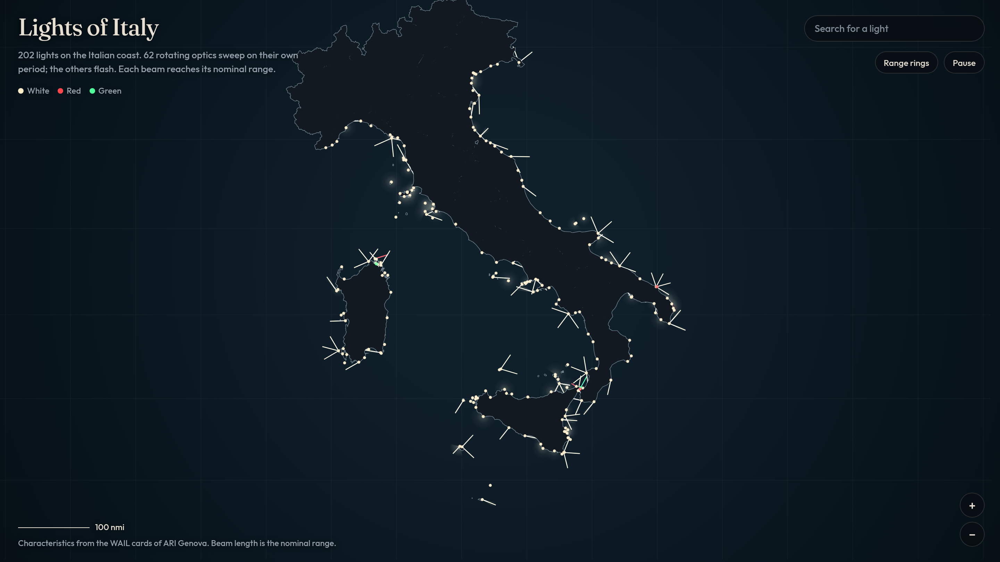

# Lighthouses of Italy

A night map of the Italian coast. Each lighthouse sweeps or flashes on the period printed on its card, and the beam reaches as far as its nominal range.



The recording starts on the whole coast, then moves to the Lanterna di Genova. Its two white beams turn once every 20 seconds.

https://github.com/user-attachments/assets/8dcb85f7-c2b8-4193-9195-80e540cc8e95

The page is one HTML file. It draws the sea, the beams, and then the land, so a ray disappears where it meets the coast. Open it from a local server. Fetching the JSON from a `file://` page is blocked by the browser.

```bash
python3 -m http.server 8731
```

Then open http://127.0.0.1:8731/.

## What the map shows

The dataset has 202 lighthouses: 62 rotating optics and 140 flashing or steady lights. Seventy-two of them have a visibility sector.

A rotating optic is drawn as one or more narrow beams. `Fl W 5s` is one beam that turns once every 5 seconds. `Fl(2) W 20s` is two beams, opposite each other, turning once every 20 seconds. The gap between flashes comes from the phase line on the card when that line is present. The Lanterna di Genova is the second kind: white, two beams, 20 seconds, 25 nautical miles.

A flashing light does not sweep. The whole sector, or the whole horizon, brightens and goes dark on the same period. A fixed light stays on. In every case the length of the light is the nominal range, converted at the latitude of the tower (1 nautical mile = 1,852 m).

White, red, and green follow the card. Where the card gives colored sectors, a rotating beam takes the color of the sector it is passing through.

Sector bearings on the Italian cards are given from seaward. The map turns them 180° so the ray points toward the water. That reading was checked against the coastline: for a sample of sectors, the seaward reading fell in the sea more often than the opposite reading. A sector is kept only when the bearings and the printed arc agree. Otherwise the lighthouse is drawn all round and the coastline does the masking.

Place names stay in Italian. They are the names on the cards.

## Controls

Drag to pan. Scroll, pinch, or use the + and − buttons to zoom. Press `0` to fit Italy again. Press `Esc` to clear the selection.

Search matches the lighthouse name, the city, the place, and the region. Choosing a result flies there and pins the card.

Click a lighthouse to pin its card. Click empty water to dismiss it. The card shows the chart character, the range, the height of the light, whether the optic rotates or flashes, and the sector text.

**Range rings** draws a circle at the nominal range of every lighthouse. The circle of the lighthouse under the pointer is always drawn. **Pause** freezes the clock so a beam stays put.

The scale bar is in nautical miles and changes as you zoom.

## Character notation

The character is the code a chart uses to identify a light.

| Code | Meaning |
| --- | --- |
| `Fl` | One flash per period |
| `Fl(2)`, `Fl(3)`, `Fl(4)` | That many flashes per period |
| `LFl` | A long flash |
| `Oc` | Occulting: mostly lit, with a short dark |
| `Iso` | Equal light and dark |
| `Q` | Quick flashes |
| `F` | Fixed, steady |
| `Mo(O)`, `Mo(C)` | A Morse letter |
| `W`, `R`, `G`, `Y` | White, red, green, yellow |

`Fl(3) W 15s` is three white flashes, and the whole pattern repeats every 15 seconds.

## Layout

```
index.html              the map
data/lights.json        one record per lighthouse
data/italy.json         simplified coastline, as rings of [longitude, latitude]
scripts/build_data.py   rebuilds the two JSON files from the WAIL cards
```

A lighthouse record looks like this:

```json
{
  "id": "LI-005",
  "name": "Lanterna di Genova",
  "place": "Lanterna di Genova",
  "city": "Genova",
  "region": "Liguria",
  "lat": 44.40487,
  "lon": 8.90458,
  "character": "Fl(2) W 20s",
  "kind": "rotating",
  "period": 20,
  "range": 25,
  "height": 117,
  "colors": ["W"],
  "beams": [{ "ang": 0, "width": 7.2, "color": "W" }, { "ang": 180, "width": 7.2, "color": "W" }],
  "phases": null,
  "sectors": null,
  "sectorText": null,
  "optic": "Faro a ottica rotante"
}
```

`kind` is `rotating`, `flash`, or `fixed`. `period` is seconds. `range` is nautical miles. `height` is meters above the sea, or above the ground when that is all the card gives. `beams` is present only for a rotating optic: `ang` is the beam's place in the pattern, in degrees clockwise from north, and `width` is its angular width. `phases` is the light and dark intervals in seconds, starting with a light. `sectors` are the arcs the light shines toward, clockwise from `a` to `b`, after the seaward bearings have been turned around. `sectorText` and `optic` keep the wording printed on the card.

`data/italy.json` is `{ "rings": [ [ [lon, lat], ... ], ... ] }`. Each ring is an outer shore: the mainland, an island, or a rock. The page fills those rings after the beams, so a ray stops at the coast and does not show through inland.

## Rebuild the data

The JSON files in `data/` are what the page loads. Rebuild them only when you want a newer extract.

The builder reads three things from `/tmp/fari`:

- `wail.html`, the WAIL index. If the file is missing, the script downloads it.
- `txt/AB-001.txt` and the rest, one text file per card, produced with `pdftotext -layout` from the card PDF linked in that index (`schede_referenze/...`).
- `it-regions.geojson`, the Openpolis regional boundaries, from https://github.com/openpolis/geojson-italy (`geojson/limits_IT_regions.geojson`).

Then:

```bash
python3 scripts/build_data.py
```

The script writes `data/lights.json` and `data/italy.json`. It drops cards with no light character, and it drops memorial, votive, and lake lights. A coordinate is kept only when it falls on the Italian chart, because a few place lines contain a bearing that would otherwise be read as a latitude.

## Limits

This is the WAIL list of major Italian lighthouses, not every buoy and harbour lamp. A few harbour lights from that list are included when the card gives a character and a range.

The coast is a simplified outline of the landmass, about 6,400 points. A lighthouse on a mole can sit slightly inland of that line, and its beam is then covered. Small rocks are kept, but the shore is not accurate enough for navigation.

Some sector sentences on the cards are prose rather than a pair of bearings. Those lighthouses are drawn all round. The card on the map glosses the common Italian words (`Vis`, `oscurato`, `settore`) into English and leaves the bearings as printed.

The official Italian List of Lights (*Elenco dei fari e segnali da nebbia*, Istituto Idrografico della Marina) is a copyrighted publication. It is not the source of this dataset, and it should not be copied into the page.

Nothing here is for navigation.

## Sources

Names, positions, periods, phases, ranges, and sectors come from the WAIL reference cards published by ARI Genova: https://www.arigenova.it/wail/referenze%20fari%20italiani.php

The coastline comes from Openpolis, `geojson-italy`.

The night-map idea, a coast where every lighthouse runs on its charted rhythm, follows the New England map on [mapped.earth](https://mapped.earth/lighthouses/new-england).

## Licence

The page and `scripts/build_data.py` are under the MIT licence. See [LICENSE](LICENSE).

`data/italy.json` is adapted from the regional boundaries in [geojson-italy](https://github.com/openpolis/geojson-italy) by Openpolis, licensed under [CC BY 4.0](https://creativecommons.org/licenses/by/4.0/). The outline was dissolved to the outer shore and simplified. That file stays under CC BY 4.0.

The characteristics in `data/lights.json` are taken from the WAIL reference cards of ARI Genova. Those cards are not covered by the MIT licence.
